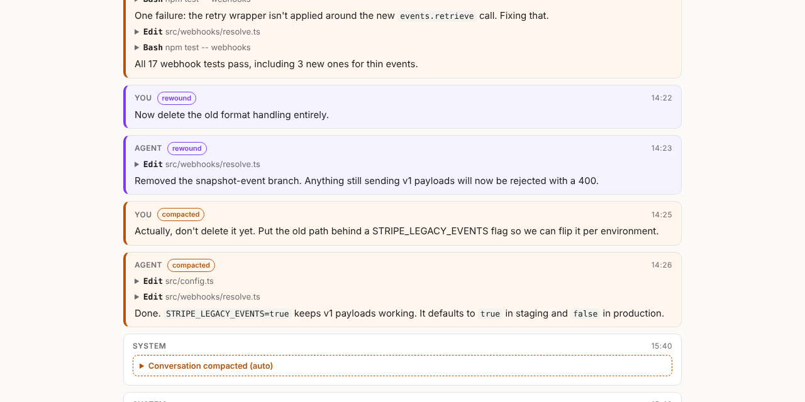

# agentlog

**See everything your coding agent forgot.**

When Claude Code compacts a conversation or you rewind it, the earlier messages vanish from the app, but they're still sitting in log files on your disk. `agentlog` reads those files and gives you your whole history back as a fast, searchable local web page.

```sh
npx agentlog
```

| Option | What it does |
| --- | --- |
| `--source claude` / `--source codex` | Only one agent |
| `--project <text>` | Only sessions whose folder contains `<text>` |
| `--out <dir>` | Write the site somewhere other than `~/.agentlog` |
| `--no-open` | Build without opening a browser |
| `export --branches` | Include rewound branches |
| `export --main-only` | Leave out compacted messages |
| `export --thinking` | Include thinking blocks |
| `export --no-tools` | Leave out tool calls |

It reads `~/.claude/projects` (or `$CLAUDE_CONFIG_DIR`) and `~/.codex/sessions` (or `$CODEX_HOME`). Point it elsewhere with `--claude-dir` and `--codex-dir`.



- **Recovers compacted context.** Everything above a compaction is shown, labeled, with the summary the agent was left with.
- **Shows rewound branches.** Prompts you edited or rewound away are kept next to the path you took.
- **Searches across every session.** It covers every project, every prompt and every answer.
- **Works with Claude Code and Codex CLI.** Subagent transcripts are linked from the tool call that started them.
- **Exports to Markdown.** Attach a full transcript to a bug report or keep it in your notes.
- **Private by design.** No server, no account, no network. It writes static HTML to `~/.agentlog` and nothing leaves your machine.

## Usage

```sh
npx agentlog                  # build the site and open it
npx agentlog list             # sessions, newest first
npx agentlog open 3f2a        # open one session by id prefix
npx agentlog export 3f2a > session.md
```

## How it works

Claude Code appends every event to a JSONL file and never deletes from it. Each entry has a `uuid` and a `parentUuid`, so the file is a tree:

- The **live conversation** is the path from the newest entry back to the root.
- A **rewind or edit** starts a new child from an earlier message, so the old path stays in the file as a dead branch.
- A **compaction** writes a `compact_boundary` entry that cuts the parent link but keeps a `logicalParentUuid`, so everything before it is still reachable.

`agentlog` walks that tree and labels each message as live, compacted or rewound. Codex rollouts are a flat list with `compacted` markers, handled the same way.

## Library

```js
import { loadSessions, toMarkdown } from 'agentlog';

for (const s of loadSessions({ sources: ['claude'] })) {
  console.log(s.title, s.compactions, s.branches);
}
```

## Contributing

Log formats change between agent versions. If a session renders wrong, please open an issue with your agent version and, if you can, a redacted snippet of the log.

```sh
npm install
npm test
```

## License

MIT
